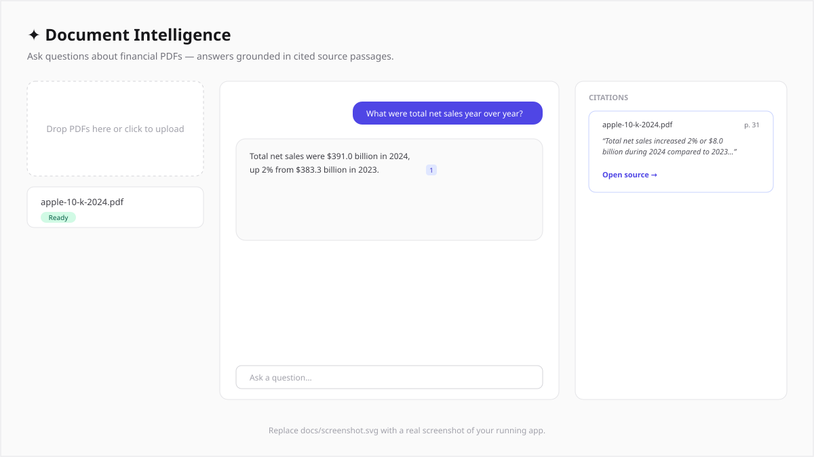

# Document Intelligence

Upload financial documents (10-Ks, annual reports, contracts) and ask
natural-language questions. Every answer is grounded in the source text, with
inline citations that open the exact page of the original PDF and highlight the
cited passage. If the answer isn't in the documents, the app says so instead of
guessing.



> The image above is a placeholder — replace `docs/screenshot.svg` with a real
> screenshot of your running app.

---

## What it does

1. **Ingest** — parse each PDF one page at a time (page numbers preserved),
   split pages into overlapping chunks, embed each chunk, and store the vectors
   plus `{document, page}` metadata in Postgres/pgvector. The raw PDF bytes are
   stored in the database too, so there's no object storage or disk to manage.
2. **Retrieve** — embed the question and pull the top-k most similar chunks with
   a cosine-distance search, optionally scoped to a subset of documents.
3. **Generate** — pass each retrieved chunk to Claude as its own `document`
   block with the **native Citations API** enabled. Claude can only cite text it
   was given, so citation markers can't be hallucinated. Each returned citation
   is mapped back to its document name and page.
4. **Cite** — the answer renders with inline `[n]` chips. The citations panel
   lists each source with its exact quote and page; clicking one opens the real
   PDF page in a side panel with the passage highlighted.

## Architecture

```
                 ┌─────────────┐   PDF bytes + per-page text
  upload  ─────▶ │  /api/ingest │───────────────────────────────▶  Postgres
                 └─────────────┘   chunks + embeddings (pgvector)      │
                       ▲                                               │
                       │  unpdf → chunk → Voyage embeddings            │
                                                                       │
                 ┌─────────────┐   embed question → match_chunks()     │
  question ────▶ │  /api/query  │◀──────────────────────────────────────┘
                 └─────────────┘   top-k chunks
                       │
                       ▼  chunks as `document` blocks, citations: enabled
                 ┌─────────────┐
                 │  Claude API  │──▶  answer + grounded citations → UI
                 └─────────────┘
```

Code is split by stage:

| Path | Responsibility |
|---|---|
| `src/lib/ingestion/` | `pdf.ts` (per-page extraction), `chunk.ts` (recursive splitter), `ingest.ts` (orchestration + persistence) |
| `src/lib/embeddings/` | provider interface + `voyage.ts` / `openai.ts` REST wrappers, selected by `EMBEDDING_PROVIDER` |
| `src/lib/retrieval/` | `search.ts` — embed query, call the `match_chunks` SQL function |
| `src/lib/generation/` | `prompt.ts` (grounding + refusal rules), `answer.ts` (Citations API call + citation mapping) |
| `src/app/api/` | route handlers: `ingest`, `query`, `documents`, `documents/[id]`, `documents/[id]/file`, `health` |
| `src/components/` | `UploadDropzone`, `DocumentList`, `AnswerBubble`, `CitationsPanel`, `SourceViewer` + `PdfView` |
| `db/migrations/` | schema: `documents`, `document_files`, `pages`, `chunks` + `match_chunks()` |

## Tech

- **Next.js 16** (App Router) · **TypeScript** · **Tailwind CSS v4**
- **@anthropic-ai/sdk** — answer generation with the native Citations API
- **Voyage AI** (`voyage-3.5`, default) or **OpenAI** for embeddings — no
  Anthropic embeddings endpoint exists; chosen via `EMBEDDING_PROVIDER`
- **Postgres + pgvector** — deploy-friendly vector store (Supabase in
  production; any pgvector Postgres locally)
- **pg** for data access, **unpdf** for serverless PDF text extraction,
  **react-pdf** for rendering cited pages, **zod** for env + request validation

---

## Setup

### 1. Prerequisites

- Node.js 20+
- A pgvector-capable Postgres. Any one of:
  - **Postgres.app** (macOS) — ships with pgvector, nothing to install
  - `docker compose up -d` using the bundled `docker-compose.yml`
  - A hosted Postgres (e.g. Supabase)
- An **Anthropic API key**
- A **Voyage AI API key** (or an OpenAI key if you set `EMBEDDING_PROVIDER=openai`)

### 2. Install

```bash
npm install
cp .env.example .env.local
```

Fill in `.env.local`:

```ini
DATABASE_URL="postgresql://<user>@localhost:5432/document_intelligence"
ANTHROPIC_API_KEY="sk-ant-..."
EMBEDDING_PROVIDER="voyage"
VOYAGE_API_KEY="pa-..."
EMBEDDING_MODEL="voyage-3.5"
EMBEDDING_DIMENSIONS="1024"
```

> `EMBEDDING_DIMENSIONS` must match the model. `voyage-3.5`, `voyage-3-large`,
> and `voyage-finance-2` are all 1024; OpenAI `text-embedding-3-small` is 1536.
> The migration reads this value to size the `vector` column — if you change it
> later, run `npm run db:reset`.

### 3. Create the database & schema

```bash
# create the database once (skip if it already exists / you use docker-compose)
createdb document_intelligence

npm run db:migrate
```

### 4. Run

```bash
npm run dev
# http://localhost:3000
```

Upload a PDF, wait for its status to turn **Ready**, then ask a question. The
top-right of the header shows the models in use; a banner appears if any
required env var is missing.

### Test documents

There's no watch folder — upload through the app's dropzone. `sample-docs/`
is a local (git-ignored) place to keep test files. Good public filings:

| Document | Where |
|---|---|
| Berkshire Hathaway shareholder letter (short, prose-heavy — great for Q&A) | <https://www.berkshirehathaway.com/letters/2023ltr.pdf> |
| Apple Inc. FY2024 Form 10-K | [investor.apple.com](https://investor.apple.com) → SEC Filings, or SEC EDGAR (CIK 0000320193) |
| A credit agreement / contract exhibit | [SEC EDGAR full-text search](https://efts.sec.gov/LATEST/search-index?q=%22credit+agreement%22) → any filing's exhibits |

Example questions:

- *"What were total net sales and how did they change year over year?"*
- *"Summarize the key risk factors related to supply chain."*
- *"What does the agreement say about termination and notice periods?"*
- Ask something not in the document — it should decline rather than answer.

### Scripts

| Command | Description |
|---|---|
| `npm run dev` | start the dev server |
| `npm run build` / `npm start` | production build / serve |
| `npm run typecheck` | `tsc --noEmit` |
| `npm run db:migrate` | apply pending migrations |
| `npm run db:reset` | drop app tables and re-apply from scratch |
| `node scripts/smoke-ingest.mjs <file.pdf>` | test PDF parsing without a DB or keys |

---

## Deploy to Vercel

1. **Database — Supabase.** Create a project. In the SQL editor, enable
   pgvector (`create extension if not exists vector;`), or just let the
   migration do it. Copy the connection string from **Project Settings →
   Database** (use the pooled `:6543` connection string for serverless).

2. **Run the migration against Supabase** from your machine:

   ```bash
   DATABASE_URL="postgresql://postgres.<ref>:<pw>@aws-0-<region>.pooler.supabase.com:6543/postgres" \
   EMBEDDING_DIMENSIONS=1024 \
   npm run db:migrate
   ```

3. **Import the repo into Vercel.** Framework preset: Next.js (autodetected).

4. **Set environment variables** in the Vercel project (Production + Preview):

   | Variable | Value |
   |---|---|
   | `DATABASE_URL` | Supabase pooled connection string |
   | `ANTHROPIC_API_KEY` | your key |
   | `EMBEDDING_PROVIDER` | `voyage` |
   | `VOYAGE_API_KEY` | your key |
   | `EMBEDDING_MODEL` | `voyage-3.5` |
   | `EMBEDDING_DIMENSIONS` | `1024` |

5. **Deploy.** `/api/ingest` sets `maxDuration = 300` for large filings — that
   ceiling requires a Vercel plan above Hobby (Hobby caps at 60s). On Hobby,
   stick to documents under ~80 pages.

Everything else (PDF storage, vectors, page text) lives in Postgres, so there's
nothing else to provision.

---

## Notes & trade-offs

- **Chunks never span a page break**, so every chunk has an exact page number.
  The cost is that a sentence split across pages is divided — fine for filings.
- **Citations are grounded by construction.** Claude only ever sees the
  retrieved passages as `document` blocks, and the Citations API returns the
  exact `cited_text`; the app maps that back to `{document, page}`.
- **Highlight matching** in the PDF viewer normalizes whitespace and matches
  text-layer items against the cited span; on rare layout-heavy pages a phrase
  may not highlight even though the page and citation are correct.
- **Model** defaults to `claude-sonnet-5`; change `ANTHROPIC_MODEL` to switch.
